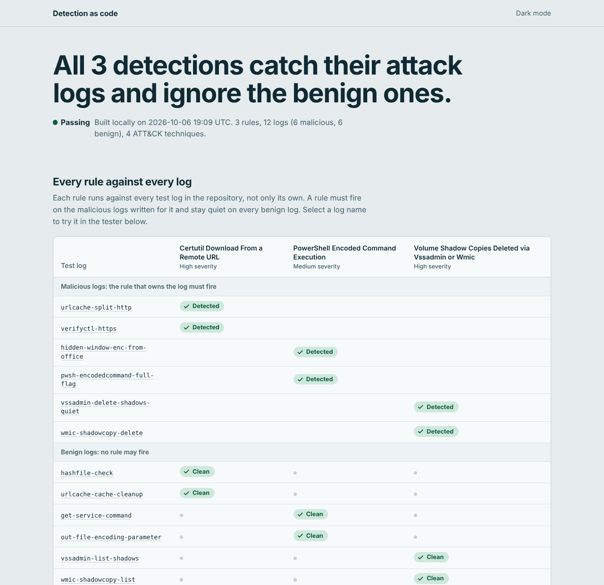

# detection-as-code

Sigma detection rules stored in Git, with CI that tests every rule against benign and malicious sample logs and publishes the results as a dashboard.



A detection is a control: it only helps if it fires on the behaviour you care about and stays quiet on everything else. Treating rules as code means each change is reviewed, tested and traceable, and a rule that stops working fails the build instead of failing silently in production.

## Start here

The whole idea is one loop: write a rule, give it one malicious log and one benign log, and run a test that checks both.

1. The rule: [`rules/windows/proc_creation_powershell_encoded_command.yml`](rules/windows/proc_creation_powershell_encoded_command.yml)
2. Its logs: `tests/cases/proc_creation_powershell_encoded_command/malicious/` and `.../benign/`, one JSON event per file
3. The test: [`tests/test_rules.py`](tests/test_rules.py), which runs every rule against every log

```bash
git clone https://github.com/MuhammadMurtuzaHussain/detection-as-code.git
cd detection-as-code
python3 -m venv .venv && source .venv/bin/activate
pip install -r requirements-dev.txt

python -m pytest -q      # the gate CI runs
python -m dac check      # the same checks as a readable table
make serve               # build the dashboard and open http://localhost:8000
```

```
PASS  proc_creation_certutil_url_download       high      2/2 malicious detected, 2/2 benign clean
PASS  proc_creation_powershell_encoded_command  medium    2/2 malicious detected, 2/2 benign clean
PASS  proc_creation_shadow_copy_deletion        high      2/2 malicious detected, 2/2 benign clean

Cross-rule false-positive check: 6 benign logs against 3 rules, 0 violations
Result: PASS
```

The three rules (encoded PowerShell, certutil downloads, shadow copy deletion) are Windows process-creation detections mapped to ATT&CK. The first is the "start here" rule. The other two show that the pattern scales without changing the harness.

## What CI enforces

On every push and pull request, CI fails if any of these is false:

- Every rule has the metadata a reviewer needs: a UUID, status, severity, author, date, log source, known false positives, and at least one ATT&CK tactic and technique tag.
- The detection compiles. Sigma syntax the engine does not support raises an error instead of being ignored, so a rule can never pass because a modifier was silently skipped.
- Every rule has at least one malicious and one benign log.
- Every malicious log fires its rule. Every benign log does not.
- No rule fires on any other rule's benign logs. The benign logs of the whole repository act as a shared false-positive corpus, and it grows with every rule.
- Test logs are valid JSON, and none is orphaned from a rule.
- The JavaScript engine used by the dashboard returns the same verdict as the Python engine on every log and on a shared set of engine test vectors.

Pushes to `main` that pass then publish the dashboard to GitHub Pages. The workflow also writes a results table to the job summary.

The harness itself is tested too ([`tests/test_harness.py`](tests/test_harness.py)). It builds deliberately broken rule sets (a rule that matches everything, one that matches nothing, a missing benign log, a cross-rule false positive) and asserts that the runner reports each one. A green build only means something if a broken rule would turn it red.

## The dashboard

`python -m dac build` writes `site/index.html`, one self-contained page with no server behind it. CI publishes it to GitHub Pages.

- A matrix of every rule against every log. The chip on each row marks the rule that owns the log, and a stray alert on any other rule shows up as a false alarm.
- A tester: paste a JSON event, or start from a test log and edit it, and see which rules fire. Evaluation happens in the browser and nothing is uploaded.
- ATT&CK tactic coverage, so gaps are visible and suggest the next rule to write.
- Each rule's YAML, known false positives and test logs, with the verdict for each log.

The page is static on purpose. It has nothing to host or patch, it can be reviewed like any other file, and the results it shows are the ones CI produced for that commit.

## Adding a rule

1. Create `rules/<platform>/<name>.yml`. The file name (without `.yml`) is the rule's key.
2. Create `tests/cases/<name>/malicious/<what-it-is>.json` and `tests/cases/<name>/benign/<what-it-is>.json`. One event per file. Name them for what they prove.
3. Include at least one near miss among the benign logs, a command that looks like the attack but is not. The `-Encoding utf8` log for the PowerShell rule is an example.
4. Run `python -m dac check`, then `python -m pytest -q`.
5. Open a pull request. CI runs the same gate.

## Supported Sigma

The engine in [`dac/engine.py`](dac/engine.py) covers what these rules need:

| Area | Supported |
|---|---|
| Selections | Maps (fields ANDed), lists of maps (ORed), value lists (ORed, or ANDed with `all`) |
| Modifiers | `contains`, `startswith`, `endswith`, `re` (with `i`, `m`, `s`), `all` |
| Values | `*` and `?` wildcards with `\*` and `\?` escapes, numbers, null, dotted paths into nested events |
| Conditions | `and`, `or`, `not`, parentheses, `1 of` and `all of` with wildcards or `them`, condition lists |

Everything else raises `UnsupportedFeature`: aggregations such as `count()`, `near`, `timeframe`, keyword searches and the remaining modifiers (`base64`, `cidr`, `windash`, `lt`/`gt` and so on).

Sigma strings are matched case-insensitively. Regular expressions are case-sensitive unless flagged, as in the Sigma specification. In plain values, `\\*` means a literal backslash followed by a wildcard, whereas `\*` is a literal asterisk. That is a common source of rules that quietly match nothing, and [`tests/engine_vectors.json`](tests/engine_vectors.json) pins the behaviour down.

This is not a replacement for [pySigma](https://github.com/SigmaHQ/pySigma). The rules are plain Sigma, so they stay portable, and pySigma is the right tool to convert them for Splunk, Elastic or Sentinel. This engine exists to run rules against logs inside CI and in the browser with no SIEM.

## Layout

```
rules/windows/                 Sigma rules
tests/cases/<rule>/malicious/  logs that must fire the rule
tests/cases/<rule>/benign/     logs that must not
tests/test_rules.py            the detection gate
tests/test_harness.py          tests of the gate itself
tests/test_engine.py           engine unit tests
tests/engine_vectors.json      engine behaviour shared by Python and JavaScript
tests/parity.test.js           JavaScript vs Python agreement
dac/                           loader, engine, runner, CLI, dashboard builder
dac/web/                       dashboard template, styles, app and the JavaScript engine
.github/workflows/ci.yml       lint, test, parity, build, publish
```

## Governance angle

Detections are controls, and testing them in CI turns "we have monitoring" into evidence that specific detections work and keep working after each change. That supports, but does not by itself satisfy, ISO/IEC 27001:2022 Annex A 8.15 (logging) and 8.16 (monitoring activities), and NIS2 Article 21(2)(b) (incident handling) and 21(2)(f) (assessing the effectiveness of cybersecurity risk-management measures). The commit history and the CI record show who changed which rule, why, and what it was tested against.

## About the test data

Every log is synthetic. Hostnames use the reserved `.example` and `.invalid` domains, the one IP address is from the RFC 5737 documentation range (203.0.113.0/24), and the Base64 payloads decode to harmless `Write-Output` strings. A pass shows that a rule does what its author intended on these samples. It does not show that the rule catches every real attack or stays quiet in your environment.

## Ideas for next

- Convert each rule with pySigma in CI for Splunk, Elastic and Sentinel, and fail the build if a conversion breaks.
- Generate an ATT&CK Navigator layer from the rule tags.
- Replay real Windows event logs with a tool such as Chainsaw or Hayabusa to check rules against real telemetry.
- Mutation tests: automatically obfuscate each malicious log (case changes, caret escapes, argument reordering) and report which variants evade the rule.
- Fill the empty ATT&CK tactics on the dashboard, starting with credential access and discovery.

## Licence

MIT. See [LICENSE](LICENSE).
# detection-as-code
